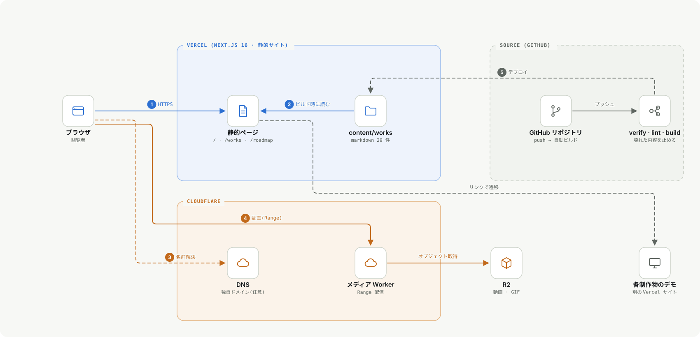

# 制作物まとめサイト 設計書(2026-11-07)

**状態**: 実装済み・**Vercel に公開済み(2026-11-08)**: https://portfolio-one-iota-tnzj90iibk.vercel.app 。UI の決めごとは [IMPROVEMENT_DESIGN_2026-10.md](IMPROVEMENT_DESIGN_2026-10.md) の「決めごと表」に従う(タイポグラフィ主役・差し色 1 つ・罫線 1px・影なし・遊びは 404 に集める)。
**個人情報**: 連絡先・経歴の詳細は載せない。公開する範囲は本人が決める。

## 1. 目的

制作物が多く(公開リポジトリは 41 件)、GitHub のプロフィールだけでは全体が見えない。**構成図と短い説明で、まず全体を見渡せる場所**を作る。一次の情報は各リポジトリ。

## 2. 技術(他のサイトと揃える)

| 項目           | 選択                                                           | 根拠                                                                                            |
| -------------- | -------------------------------------------------------------- | ----------------------------------------------------------------------------------------------- |
| フレームワーク | Next.js **16.2.10**(App Router)+ React **19.2.4** + TypeScript | The-Algorithm-Illustrated・ColorEncyclopedia・FoundationsEncyclopedia・LoreHub と同じ版         |
| 内容の読み込み | **gray-matter + marked**(markdown + frontmatter)               | 上の 3 つの図鑑と同じ方式。コードを変えずに作品を足せる                                         |
| 書体           | Geist(見出し)+ Zen Kaku Gothic New(本文)。`next/font/google`   | WeatherGeoBridge が Geist、ColorEncyclopedia が Zen Kaku Gothic New。**2 書体まで**(決めごと表) |
| テーマ         | ライト既定 + ダーク切り替え。描画前に決める初期化スクリプト    | 他のサイトと同じ作り                                                                            |
| 配信           | **Vercel**(静的に出力)                                         | 他のサイトと同じ                                                                                |
| メディア       | **Cloudflare R2 + Range 対応の Worker**                        | RAGReel のギャラリー(`cloudflare/ragreel-gallery`)の仕組みを流用                                |
| DNS            | Cloudflare(独自ドメインを使うとき)                             | 任意。Vercel 向けは「DNS のみ」(プロキシなし)にする                                             |
| 検査           | `npm run verify`(内容の形。`prebuild` で自動実行)+ `eslint` + `next build` | 壊れた内容を公開前に止める                                                                      |

- **追加の依存は gray-matter・marked・Next/React・TypeScript・ESLint だけ**。Tailwind・アニメーションのライブラリは使わない(他の図鑑サイトに揃える)。

## 3. 構成図

## 4. 画面

| 画面         | URL             | 内容                                                                                                       |
| ------------ | --------------- | ---------------------------------------------------------------------------------------------------------- |
| トップ       | `/`             | 大きな見出し 1 つ・一文の紹介・件数 → 「まずはここから」(代表作 3 件)→ ロードマップへ                      |
| 制作物       | `/works`        | 入口 3 つ(**まずはここから**=代表作 / **技術から**=2 件以上で使う技術ごと / **すべて**=分類ごとの一覧)。**行を開く(`
`)**と概要・技術・リンク。JavaScript なしで、キーボードでも開閉できる |
| 制作物の詳細 | `/works/[slug]` | 概要・技術・**構成図**・(あれば)動画・本文・前後の移動。1 件ずつ共有できる URL                             |
| ロードマップ | `/roadmap`      | 今後の道筋の図 + カテゴリ別の項目数。中身は GitHub の ROADMAP.md へ                                        |
| ABOUT        | `/about`        | 制作の軸・**TA スキルレーダー**(`public/diagrams/ta-skill-radar.svg`)・このサイトについて                  |
| 404          | —               | 迷子の点が 1 つ揺れる(`prefers-reduced-motion` では止まる)                                                 |

- ナビは字間の広い小さな英字(HOME / WORK / ROADMAP / ABOUT)。選択中だけ濃く、下に差し色の線。
- 構成図は、スマホで小さくなるため**タップで大きく開く**(別タブの SVG)。

## 5. データ(`content/works/*.md`)

1 件 = 1 ファイル。frontmatter: `title` `subtitle` `category` `order` `since` `featured` `summary` `tech[]` `github` `demo` `diagram` `video`。

- `category` は 卒業研究 / アプリ・Web / 補助ツール / 学習成果物 / ゲーム のどれか(`npm run verify` が検査)。
- `github` は `https://github.com/manato1201/…` の形のみ、`demo` は `https` のみ、`diagram` は `public/diagrams/` に実在するもののみ。
- 本文に `<script>` を入れない(検査で止める)。本文は自作の markdown だけを入れる前提で、HTML に変換して出す。

## 6. 方針(決めごと)

- **装飾は差し色 1 つ**(白地で 5:1 以上: `#b43a0a`=地 5.66:1・淡い面 5.17:1、ダークは `#fb923c`=8.28:1。2026-11-08 に計算で確認)。
- 動きは**トップの見出しの出現**と**404 の点**だけ。すべて `prefers-reduced-motion` で止める(P8)。隠れるヘッダー・スクロールスパイ・慣性スクロールなどの追補は、この方針と依存の少なさを優先して**採用しない**。
- スマホ幅(520px 以下)はヘッダーが 2 段になるため、固定をやめて画面を広く使う。
- 幅 360px で横スクロールが出ない(表は自身の入れ物の中で収める)。
- アナリティクスは**入れない**(入れる場合は目的を先に決める)。

## 7. Phase

| Phase | 内容                                        | 状態                                                                  |
| ----- | ------------------------------------------- | --------------------------------------------------------------------- |
| 0     | 決めごと表、作品の下書き                    | 済(制作物 29 件。UnityGameJam_B だけ説明が未記入)                                         |
| 1     | 初期テンプレートの除去、トップ・ナビ        | **済**                                                                |
| 2     | 制作物の一覧(開閉)・詳細・ロードマップ      | **済**                                                                |
| 3     | 404・ダーク・メタ情報(OGP・sitemap・robots) | **済**(OGP 画像は `src/app/opengraph-image.tsx`。英数字のみ)          |
| 4     | **公開**(Vercel・Cloudflare の設定)         | **Vercel は済**(GitHub 連携で push ごとに自動デプロイ)。独自ドメイン・Cloudflare は未 — [DEPLOY.md](DEPLOY.md) |
| 5     | 動画・GIF を R2 に置いて詳細に出す          | 未(仕組みは入れた。`NEXT_PUBLIC_MEDIA_BASE` と `video:` で有効になる) |

## 8. 検証チェックリスト

- [x] `npm run verify` / `eslint` / `next build` が通る
- [x] 幅 390px で表示が崩れない(目視)
- [x] 幅 360px で横スクロールが出ない(2026-11-08: 全ページ計測)
- [ ] 実機のスマホで、アコーディオンがタップ・キーボードで開閉できる
- [x] 色のコントラスト(差し色の小さな文字)を測る(2026-11-08: ライト 5.66:1 / ダーク 8.28:1)
- [ ] 公開する内容の範囲を、本人が確認した
- [ ] テンプレートの文言・ロゴが残っていない(済。`public/` の旧ロゴは `git` から削除済み)

## 9. 未確認・リスク

- 公開 URL は Vercel の自動ドメイン(`NEXT_PUBLIC_SITE_URL` に設定済み)。独自ドメインを使うかは未決定。
- UnityGameJam_B の説明は本人が書く(GitHub にも説明が無い)。LinuxNetworkGame は内容が分からないため載せていない。
- ゲーム 3 作品(piece-peace・JunkShooting・AdvancedVAT)の説明は、各リポジトリの ARCHITECTURE.md から書いた。内容が合っているか確認する。
- ロードマップの「項目数」は `src/lib/roadmap.ts` に手で持っている(元の ROADMAP.md が変わったら合わせる)。
- 他の Vercel サイトのデモの URL は 2026-11-07 に応答(200)を確認した。変わったら `content/works` を直す。
